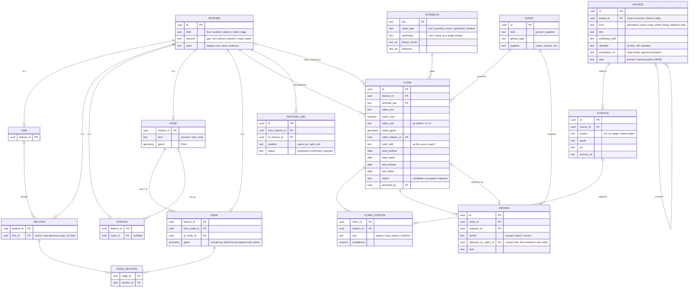

# The store model (draft)

Working draft. Iterate here until it is stable, then write the migrations.

## Principles

- **A feature is an identity, nothing more.** Lines, sections, stations, nodes and edges are
  rows with an id. Everything a source says about one is a claim.
- **There are no fixed attributes.** Name, operator, commodity, route and diameter can all
  change. "Fixed" only means we have seen one value so far.
- **Cardinality is per instant, not over all time.** `diameter` is `one`: at most one value
  is true at any moment, but it can change in 1920. `serves` is `many`. Two `one` claims with
  overlapping validity are a disagreement, and both are kept.
- **One citation supports many claims.** A trade-press passage stating a diameter, an
  operator and a new station is one citation and several claims.
- **Facts and judgements are separate (I-0005).** Citations and the claims they support are
  what sources said. Identity (`FEATURE_LINK`) and topology (`NODE`, `EDGE`) are our
  construction, built from accepted claims.
- **The research partner's one-row-per-section-per-year table is an output.** `release`
  builds it as a view. Storage does not look like it.

## ERD

Not drawn: trigger-based history tables on every table, so writes straight from QGIS are
audited too.

## Attributes (starting set)

| Key | Applies to | Type | Cardinality |
| --- | --- | --- | --- |
| `name` | line, section, station | text | one |
| `owner` | line, section, station | text | many (joint ownership) |
| `operator` | line, section, station | text | one |
| `commodity` | line, section | enum | one |
| `status` | all | enum: proposed, permitted, under_construction, operational, maintenance, decommissioned | one |
| `route` | section | geometry (LineString) | one |
| `location` | station, node | geometry (Point) or place text | one |
| `diameter` | section (pipelines) | quantity | one |
| `voltage` | section (electric) | quantity | one |
| `gauge`, `lanes` | section (road, rail) | quantity | one |
| `station_kind` | station | enum: pump, compressor, substation, terminal, intake, delivery | one |
| `serves` | station | feature (section) | many |
| `parallel_to` | section | feature (section) | many |
| `flow_direction` | edge | enum: forward, reverse, both (relative to from/to) | one |

Twinning and looping: a twin is its own section with its own build date, owner and
diameter, linked to the original by `parallel_to`. `diameter` stays single-valued.

## Worked example

> Foo Bar Oil Co. announced that their 20" pipeline upgrade to the Kansas Pipeline is
> completed and began operation in October (1920) with a new pumping station in BFE, Kansas.

One `SOURCE` (the issue, child of the journal), one `CITATION` (page and quote), and these
claims, each linked to that citation:

| Feature | Attribute | Value | Valid |
| --- | --- | --- | --- |
| section S1 | `diameter` | 20 in | from 1920-10 |
| section S1 | `operator` | Foo Bar Oil Co. | at 1920-10 |
| station ST1 (new) | `location` | BFE, Kansas | from 1920-10 |
| station ST1 | `station_kind` | pump | from 1920-10 |
| station ST1 | `serves` | S1 | from 1920-10 |

An earlier citation supports S1 `diameter` 6 in for 1898..1920. The two don't conflict
because their intervals don't overlap.

## The research partner's columns

| Their column | Here |
| --- | --- |
| PipeID / PipeIDName | `LINE` + `name` claim |
| SectionID, a/b/c splits | `SECTION` + `FEATURE_LINK split_into` |
| ObjectID, Year | generated by the year-sliced view |
| YearConstructed / YearDecommissioned | derived from `status` claims |
| EndpointCoordinates, StatesCrossed | derived from `route` geometry |
| LineType | `commodity` claim |
| Ownership(s) | `owner` and `operator` |
| Size | `diameter` / `voltage` / `gauge` / `lanes`; twins are separate sections |
| Direction of flow | `flow_direction` on edges |
| Stations | `STATION` features + `serves` claims |
| MapFileBaselineTrace / MapFileConfirmationTrace | citations to a `map_sheet` source, role `map_shows` / `confirms` |
| Maps Data tab | `SOURCE` (map_sheet) with IIIF identifier and georef annotation |

## Open

- **Section to line membership** is a plain FK for v1, changed only by audited update.
  Revisit if sections move between lines (sales, absorption into another system), which
  would make it a time-bounded, cited `part_of` claim.
- **Directionality through junctions** (flow from edge A may continue to B but not C). Not
  modeled yet; probably a turn table on `NODE`.
- **Nodes and I-0007.** Nodes are recorded only where a source shows one. An edge whose ends
  no source shows still needs end nodes; decide whether those are marked as inferred.
- **Edge geometry versus route claims.** Edges are built from accepted `route` claims.
  Decide what happens to an edge when a newer route claim is accepted.
- **Claim attachment as a judgement.** Under I-0005, which section a passage is about is a
  judgement. Today that judgement is `CLAIM.feature_id`, reassigned by audited update.
